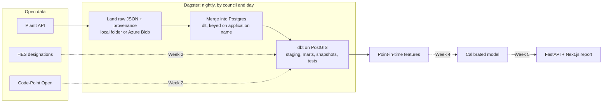

# PlotCheck: know your planning odds before you apply

[](https://github.com/chanoch01/plotcheck/actions/workflows/ci.yml)

PlotCheck tells a homeowner or architect, before they apply, which designations affect a Scottish site and how similar proposals nearby were decided. It starts with Edinburgh and Glasgow.

> **Status: Week 1 of 6.** The ingestion pipeline, warehouse models and leakage-safe features are working and tested. The classifier (Week 3), model (Week 4) and app (Week 5) are still to come. See [Roadmap](#roadmap).

## The problem

Planning decisions are public, but they are spread across council portals that answer "what was submitted?" and not "how do proposals like mine usually fare here?" A family considering a dormer pays for drawings before learning that the street is in a conservation area and that most similar dormers nearby were refused.

## How it works



| Step | Code | What it does |
| --- | --- | --- |
| Extract | [`planit.py`](src/plotcheck/planit.py) | Pages through the PlanIt API with a stable sort, a descriptive User-Agent, at least 1 s between requests, and `Retry-After` handling for HTTP 429 |
| Land | [`landing.py`](src/plotcheck/landing.py) | Stores responses exactly as received, adding `_fetched_at` and `_source_query` to every record. One file per partition, overwritten on re-run |
| Load | [`warehouse.py`](src/plotcheck/warehouse.py) | dlt merges records into `raw.planit_applications` on PlanIt's unique `name` |
| Orchestrate | [`defs.py`](src/plotcheck/defs.py) | `planit_backfill` (council × submission month) for history; `planit_changes` (council × day) nightly at 03:17 |
| Transform | [`dbt/`](dbt/) | Typed staging, `fct_applications` with an indexed British National Grid point, a status-history snapshot, and leakage-safe neighbourhood features |
| Classify | [`worktypes.py`](src/plotcheck/worktypes.py) | Regex baseline mapping descriptions to 13 work types plus `other` |

## Run it

You need Python 3.11+ and Docker.

```bash
python -m venv .venv && source .venv/bin/activate
make setup
cp .env.example .env          # then put your repo URL in PLOTCHECK_USER_AGENT

make demo                     # PostGIS + synthetic fixture + dbt build. No API calls.
make extract COUNCIL=Edinburgh MONTH=2026-09   # one real month from PlanIt
make dagster                  # UI at http://localhost:3000 for backfills and schedules
```

`make test` runs the unit tests without a database.

## Results so far

| Measure | Value | How it was measured |
| --- | --- | --- |
| Unit tests | 37 passing | `pytest`: paging, retries, rate spacing, landing, classifier, point-in-time rule, Dagster definitions |
| dbt checks | 21 passing | `dbt build`: source, staging and mart tests, snapshot, two custom tests |
| Idempotent loads | 120 rows after loading the fixture twice | Merge on `name` |
| Leakage test catches leakage | 235 failing pairs | Changing the join to allow decisions up to 120 days after submission makes `assert_comparables_point_in_time` fail and skips everything downstream |
| First live month | 450 Edinburgh applications, about 6 s | `make extract COUNCIL=Edinburgh MONTH=2026-09` on 16 Oct 2026 |

## Decisions and trade-offs

1. **Land raw before loading.** Every response is saved before it touches the warehouse, so a model change can be replayed without asking a free, volunteer-run API for the same data again. It costs storage and one extra step.
2. **Nightly updates use `different_*`, not `changed_*`.** PlanIt's `last_changed` moves whenever PlanIt re-derives fields across its whole database, which could trigger huge reloads. `last_different` moves only when the council's own page changes.
3. **The leakage rule is enforced in SQL and tested.** A comparable counts only if it was decided *before* the application was submitted. The rule lives in one model, [`int_comparable_pairs`](dbt/models/intermediate/int_comparable_pairs.sql), and a dbt test fails the build if it is ever broken.
4. **Distances use British National Grid (EPSG:27700).** Metres on a projected grid let `ST_DWithin` use a GiST index. Casting to `geography` would be simpler but slower.
5. **Column types are declared up front.** dlt creates a column only after it sees a non-null value. On a day when nothing was decided, `decided_date` would be missing and staging would break, so the loader declares every column dbt reads.

## Project layout

```
src/plotcheck/     extract, land, load, classify, features, Dagster definitions, CLI
dbt/               models (staging, intermediate, marts), snapshots, custom tests
tests/             unit tests and a synthetic fixture in PlanIt's record shape
scripts/           fixture generator
.github/workflows/ CI: lint, tests, Dagster validation, and dbt build against PostGIS
```

## Roadmap

- [x] **Week 1:** PlanIt extract, landing zone, warehouse load, Dagster backfill and nightly assets
- [ ] **Week 2:** Historic Environment Scotland designations into PostGIS; quarantine table; 20+ dbt tests *(started: 21 checks, snapshot, point-in-time features)*
- [ ] **Week 3:** Label 300 descriptions; compare the regex baseline with LLM structured output (per-class precision, recall, cost)
- [ ] **Week 4:** Point-in-time training set; LightGBM with a time-based split; calibration and SHAP
- [ ] **Week 5:** FastAPI report endpoint; Next.js and MapLibre report page with source links
- [ ] **Week 6:** Terraform to Azure Container Apps; freshness alerts; demo video

## Data and credits

- Planning applications from [UK PlanIt](https://www.planit.org.uk/), a free service run by Andrew Speakman. Please keep request rates low, and consider donating if you use it heavily.
- Designations (Week 2): contains Historic Environment Scotland and Ordnance Survey data © Historic Environment Scotland, under the [Open Government Licence v3.0](https://www.nationalarchives.gov.uk/doc/open-government-licence/version/3/).
- `tests/fixtures/` holds **synthetic** records only. They follow PlanIt's field format and describe no real applications.

PlotCheck gives an informal, data-based estimate. It is not planning or legal advice.
